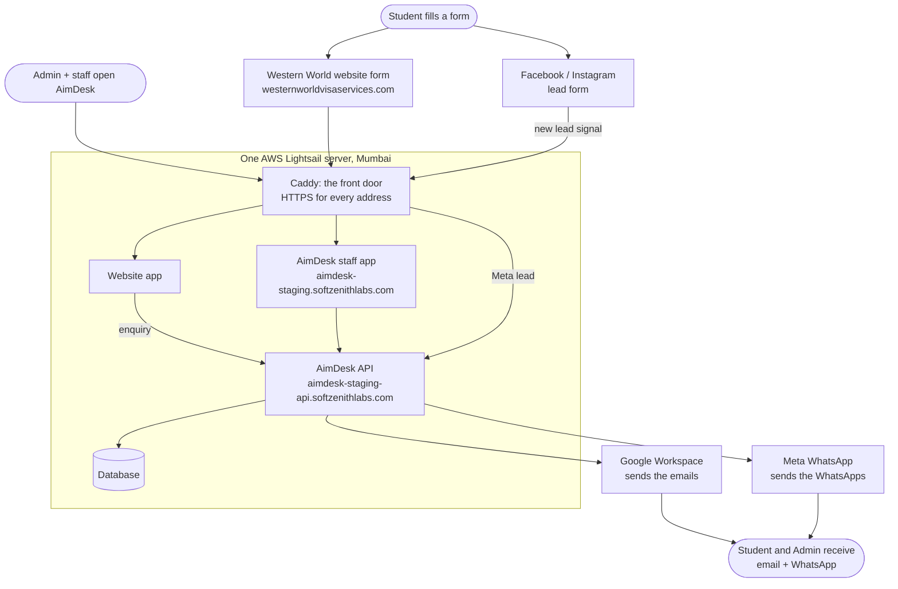
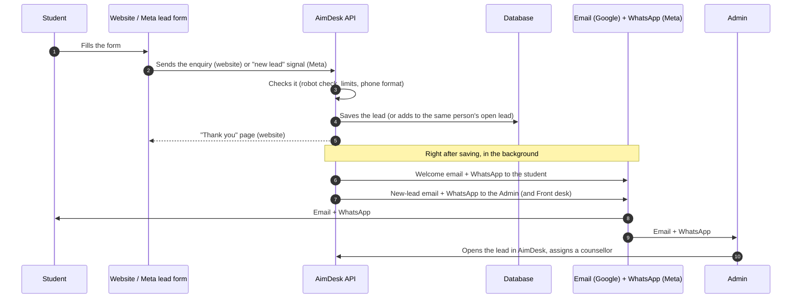
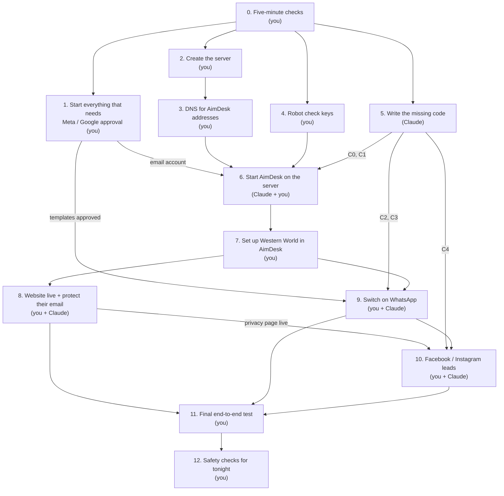
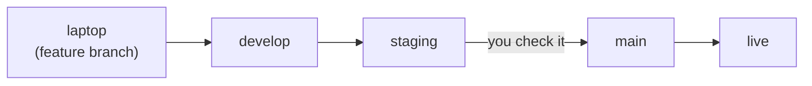
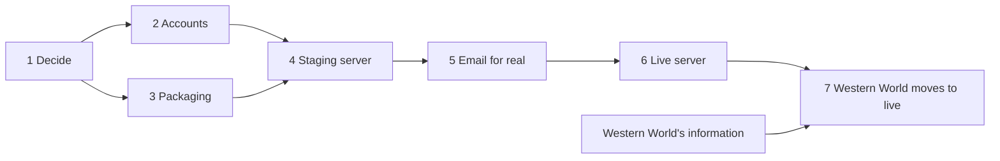

# Going live with AimDesk

How AimDesk (this CRM) gets from a laptop to a real server, in order. Written for a beginner: every step says **who**
does it, **how long** it takes, **what it needs first**, exactly **where to click**, and **how to know it worked**.

- **Part A** is the plan for **16 Oct 2026**: Western World's website live, its enquiries landing in the AimDesk
  **staging** server, Facebook / Instagram lead forms landing there too, and every new lead triggering WhatsApp + email
  to the student and to the Admin.
- **Part B** is the longer plan (separate staging and live servers), updated for what Part A changes.

Diagrams are Mermaid: they render on GitHub and in VS Code's Markdown preview (with a Mermaid extension).

> **Update 16 Oct 2026 (owner):** hosting changed to the **Oracle Cloud free tier** (US$0; Hetzner as fallback), and
> the Western World website is on **Vercel** (`westernworld-website.vercel.app` for testing). The first milestone,
> website form → staging database → Admin sees the lead, is in **`docs/staging-deploy.md`**, which replaces the
> server, DNS and start-up steps below. Where this doc says Lightsail, read "the Oracle server".

---

# Part A. Today: Western World live on the staging server

## A1. What you asked for, and what is true today

| You want | Already built? | What is missing |
|---|---|---|
| Website live at `westernworldvisaservices.com` | Website code: **yes** | Hosting + domain switch (steps 2, 8). A privacy page (code C5) |
| Form → lead in the staging database | **Yes** (public enquiry API) | A server to run it on (steps 2–6). **Packaging code (C1) is not written yet** |
| CRM on a `softzenithlabs.com` subdomain | **Yes** (staff app + console) | DNS records (step 3) |
| Email to the student + email to Admin on a new lead | **Yes** | An email account to send from (step 1.5) |
| WhatsApp to the student on a new lead | **Only a "demo" that sends nothing** | Real sender using Meta templates (code C2) + Meta account (steps 1.2–1.4) |
| WhatsApp to the Admin on a new lead | **No** (Admin gets email only) | New code (C3) |
| Facebook / Instagram lead form → same database | **No** (only the label "Meta lead ad" exists) | New code (C4) + Meta app set-up (step 10) |

So the coding is **not** mostly done for today's list: four pieces of code (C1–C4) must still be written. Claude can
write them while you do the account and DNS steps, which take the same time anyway. The table in
[step 5](#step-5-the-code-claude-writes-claude-in-parallel-with-steps-14) lists them.

**Realistic for tonight:** website live, form → CRM, emails, WhatsApp **from Meta's free test number** to up to 5
phones you register (your phone and the Admin's). **May slip to 1–3 days** because Meta reviews them: WhatsApp from
Western World's own number (display-name review), and real Facebook / Instagram leads (Meta can ask for an app review).
Start those first (step 1) so the waiting happens while everything else gets done.

> **Important: staging now holds real data.** Until now, staging was meant for test data only. From today it
> receives real students' names, phones and emails. Treat it like a live server: strong passwords, backups on, nobody
> shares the passwords in chat. When the separate live server is built (Part B), Western World's data moves there and
> staging is wiped back to test data.

## A2. The picture: what talks to what

Read it top to bottom. For a Meta lead, the API also asks Meta for the lead's details. Everything runs on **one** small
server to keep the cost down. Caddy is the "front door": it gets free HTTPS
certificates and sends each address to the right app.

## A3. The picture: what happens when a lead arrives

Every message sent (or failed) is recorded on the lead's page, so you can always check what went out.

## A4. The order of the steps

Arrows mean "must be finished first". Steps side by side can run at the same time (by you and Claude in parallel).

## A5. Cost (kept to the minimum)

| Item | Choice | Per month |
|---|---|---|
| Server (runs AimDesk, database **and** the website) | AWS Lightsail, 2 GB, Mumbai | **US$12** (check if Lightsail shows a "free for 3 months" offer on this plan) |
| Daily server backup | Lightsail automatic snapshots | about US$1–3 |
| Website hosting | On the same server | **Free** (Vercel's free plan is not allowed for business sites; Vercel Pro would be US$20) |
| Email sending | Your existing Google Workspace on `softzenithlabs.com` (up to ~2,000 emails/day) | **Free** (already paid) |
| WhatsApp | Meta WhatsApp Cloud API directly (no reseller like Interakt / AiSensy, which charge a monthly fee) | No monthly fee; Meta charges **per template message**, a small amount each. Check the India rates on Meta's [pricing page](https://developers.facebook.com/docs/whatsapp/pricing) |
| Facebook / Instagram leads to AimDesk | Meta webhook | **Free** (you only pay for the ads themselves) |
| Robot check on forms | Cloudflare Turnstile | Free |
| Domains | Already owned | No new cost |
| **Total** | | **about US$13–15/month + WhatsApp messages** |

Later saving: once Western World's email is moved off their old hosting (see step 8), their old hosting plan can be
cancelled.

---

## Before you start: what you need in hand

- A **password manager** (Bitwarden is free). Every password, key and token below goes there. Never in WhatsApp,
  email or chat, and never in Git.
- Your laptop, your phone, a credit/debit card (AWS and Meta need one).
- Logins: **Hostinger** (where `softzenithlabs.com`'s DNS is), **Namecheap** (where `westernworldvisaservices.com`
  was bought), **Google Workspace admin** for `softzenithlabs.com`, a **Facebook account** that is an admin of
  Western World's Facebook Page.
- From Western World: the Admin's **mobile** (with WhatsApp) and **email**, their branches and staff list
  (see [What the business must give us](#what-the-business-must-give-us)), and the login to their **current website
  hosting** (DataNet Hosting Solutions, see step 8).

## The steps, in order

### Step 0. Five-minute checks (you)

| Check | Why | What we found (16 Oct) |
|---|---|---|
| **Which domain is AimDesk on?** | Every address below uses it | **Confirmed (owner, 16 Oct): `softzenithlabs.com`** (DNS at Hostinger, email on Google Workspace) |
| **Does Western World use `@westernworldvisaservices.com` email?** | Their email runs on the **same old server** as their old website. Moving the website without care **breaks their email** | Their mail record (MX) points at the old server `159.89.161.124`. Step 8.3 protects it |
| **Where is their DNS edited?** | Changing the website's address happens there | **Not at Namecheap.** The domain's nameservers are `dns81/dns82.datanethostingsolutions.com`, so DNS is edited in the old hosting's control panel (usually cPanel → **Zone Editor**). Namecheap shows "Custom DNS" |
| **Which phone number will send WhatsApp?** | Meta needs one number for the business | It must **not** be active on the WhatsApp or WhatsApp Business app (delete the WhatsApp account on it first, or use a new SIM). Until it is approved, Meta's free **test number** works for up to 5 phones |
| **Who owns the Facebook Page?** | Lead forms belong to the Page | You need to be an **admin** of Western World's Page, and their Instagram must be linked to that Page (Meta Business Suite → Settings → Accounts) |

Write the answers in your password manager notes; you will use them below.

### Step 1. Start everything that needs approval (you, about 1 hour, then waiting)

Do this **first**. Meta and Google may take minutes to hours to approve things; they work on it while you do the rest.

#### 1.1 Meta business portfolio

1. Open [business.facebook.com](https://business.facebook.com) with the Facebook account that is admin of Western
   World's Page.
2. If Western World already has a business portfolio (it shows at the top left), use it and ask them to make you an
   **admin** (Settings → People → Add). If not: **Create a business portfolio** named "Western World Visa Services".
3. Settings → **Accounts → Pages**: make sure Western World's Page is listed. Settings → **Accounts → Instagram
   accounts**: their Instagram is listed.

> Why Western World's own portfolio: the app below then reads leads from **its own** Page, which Meta allows without a
> long app review. When a second business joins AimDesk, SoftZenith will need its own reviewed Meta app (later).

#### 1.2 Meta developer app (one app for both WhatsApp and lead forms)

1. Open [developers.facebook.com](https://developers.facebook.com) → **Get started** (register as a developer if asked;
   it needs your phone).
2. **My Apps → Create app** → use case **Other** → app type **Business** → name `AimDesk Western World` → contact
   email → business portfolio: **Western World Visa Services** → Create.
3. On the app's dashboard, **Add product**: **WhatsApp** (Set up) and **Webhooks** (Set up).

**Done when:** the app's left menu shows WhatsApp and Webhooks.

#### 1.3 WhatsApp number

1. In the app: **WhatsApp → API Setup**. Meta gives a free **test number** straight away.
2. Under **To**, add your mobile and the Admin's mobile (Meta sends a code to each by WhatsApp; enter it). Up to 5.
3. Still on API Setup: **Add phone number** → display name **Western World Visa Services**, category **Education**,
   then the real business number → verify it by SMS or call.
4. The **display name** goes to Meta review (hours to 1–2 days). Until then use the test number.
5. Payment: open [WhatsApp Manager](https://business.facebook.com/wa/manage/home/) → **Payment methods** → add a card.
   Without it, messages from the real number do not go out.

#### 1.4 WhatsApp message templates

WhatsApp only lets a business **start** a conversation with a pre-approved message ("template"). Create these in
WhatsApp Manager → **Message templates → Create template**, category **Utility**, language **English**. The
`{{1}}`, `{{2}}`… are filled in by AimDesk. Meta asks for a sample value for each; use the samples shown.

| Template name | Text (copy exactly) | Samples | Sent to |
|---|---|---|---|
| `lead_welcome` | `Hi {{1}}, thank you for contacting {{2}}! We have received your enquiry (ref {{3}}) and our team will reach out to you shortly.` | Riya · Western World Visa Services · WWV-000001 | The student, on a new lead |
| `new_lead_alert` | `New enquiry for {{1}}: {{2}} ({{3}}), interested in {{4}}. Lead {{5}}. Please open AimDesk to assign it.` | Western World Visa Services · Riya Sharma · +919876543210 · Study Visa Canada · WWV-000001 | Admin + Front desk, on a new lead |
| `repeat_enquiry_ack` | `Hi {{1}}, thanks for contacting {{2}} again! We have added your message to your enquiry (ref {{3}}). Our team will get in touch with you shortly.` | Riya · Western World Visa Services · WWV-000001 | The student, when they enquire again |

Approval usually takes minutes, sometimes up to a day. If Meta rejects one or moves it to "Marketing", tell Claude
the reason; the wording can be adjusted. (Status-change messages, e.g. "your counsellor is…", are left for later; until
their templates exist, AimDesk records them as "skipped" and sends them by email only.)

#### 1.5 Email sending through Google Workspace (free)

AimDesk sends as **`noreply@softzenithlabs.com`**, shown with the business name ("Western World Visa Services").

1. [admin.google.com](https://admin.google.com) → **Directory → Users** → your user → **Add alternate emails** →
   `noreply` → Save. (An alias is free; no new user needed.)
2. On that same user: turn on **2-Step Verification** ([myaccount.google.com/security](https://myaccount.google.com/security)).
3. [myaccount.google.com/apppasswords](https://myaccount.google.com/apppasswords) → name `AimDesk` → Create → copy the
   16-letter password into your password manager. (If the page says app passwords are not available: Admin console →
   Security → Less secure apps / app passwords must be allowed for the user. If you cannot enable it, tell Claude; the
   free fallback is a Brevo account, 300 emails/day.)
4. In Gmail: **Settings → Accounts → Send mail as → Add another email address** → `noreply@softzenithlabs.com`, tick
   **Treat as an alias** → Save.
5. So emails do not land in spam, add these at **Hostinger → Domains → softzenithlabs.com → DNS / Nameservers**
   (do **not** touch the existing MX record `SMTP.GOOGLE.com`):

   | Type | Name | Value |
   |---|---|---|
   | TXT | `@` | `v=spf1 include:_spf.google.com ~all` (there must be only **one** `v=spf1` record; today there is none) |
   | TXT | `google._domainkey` | From Google: Admin console → Apps → Google Workspace → Gmail → **Authenticate email** → Generate new record → copy the long value. After adding it, come back and click **Start authentication** |
   | TXT | `_dmarc` | `v=DMARC1; p=none; rua=mailto:<your email>` |

**Done when:** Google's "Authenticate email" page says **Authenticating email with DKIM**.

#### 1.6 Make the website switch quick later

In Western World's DNS panel (old hosting, see step 0), set the **TTL** of the `@` and `www` records to **300**
(5 minutes). Then the switch in step 8 takes minutes, not hours. Change nothing else yet.

### Step 2. Create the server (you, 30 minutes)

1. [aws.amazon.com](https://aws.amazon.com) → **Create an AWS account** (card + phone check; activation can take from
   minutes to a few hours). Turn on **MFA** for the root user straight away (Security credentials → Assign MFA).
2. Open [lightsail.aws.amazon.com](https://lightsail.aws.amazon.com) → **Create instance**:
   - Region: **Mumbai (ap-south-1)**, zone A
   - Platform **Linux/Unix** → **OS Only** → **Ubuntu 24.04 LTS**
   - SSH key: **Download** the default key (a `.pem` file). Save it as `C:\Users\naman\.ssh\aimdesk-staging.pem`.
   - Plan: **US$12 (2 GB RAM, 2 vCPUs, 60 GB disk)**
   - Name: `aimdesk-staging` → **Create instance**
3. **Networking → Create static IP** → attach to `aimdesk-staging`. Write the IP down (e.g. `13.233.x.x`). This
   address never changes.
4. Instance → **Networking → IPv4 Firewall**: keep **SSH (22)** and **HTTP (80)**, **Add rule → HTTPS (443)**.
5. Instance → **Snapshots → Automatic snapshots: On** (one backup copy of the whole server per day).

**Done when:** the instance shows **Running** with your static IP. Tell Claude the IP; Claude connects with the `.pem`
file (you approve each command).

### Step 3. DNS for the AimDesk addresses (you, 10 minutes + a few minutes waiting)

Needs: the static IP from step 2.

Hostinger → **Domains → softzenithlabs.com → DNS / Nameservers → Manage DNS records**. Add:

| Type | Name | Points to | TTL |
|---|---|---|---|
| A | `aimdesk-staging` | your static IP | 300 |
| A | `aimdesk-staging-api` | your static IP | 300 |
| A | `ww-preview` | your static IP (a private preview of the website before the real switch; delete after step 8) | 300 |

**Done when:** [dnschecker.org](https://dnschecker.org) shows your IP for `aimdesk-staging.softzenithlabs.com`
(usually within 5–30 minutes).

### Step 4. Robot-check keys (you, 10 minutes)

1. [dash.cloudflare.com](https://dash.cloudflare.com) → sign up (free; your domains do **not** need to move to
   Cloudflare).
2. **Turnstile → Add widget**: name `Western World + AimDesk`, hostnames:
   `westernworldvisaservices.com`, `www.westernworldvisaservices.com`, `aimdesk-staging.softzenithlabs.com`,
   `ww-preview.softzenithlabs.com`. Mode **Managed** → Create.
3. Copy the **Site key** and the **Secret key** to your password manager.

### Step 5. The code Claude writes (Claude, in parallel with steps 1–4)

| # | What | Why | Needed by |
|---|---|---|---|
| **C0** | Commit the finished-but-uncommitted work in both repos (sign-in codes, visitor address) and merge into `develop`, after you approve | The server installs from GitHub; uncommitted work would be missing | Step 6 |
| **C1** | Packaging: one "start everything" set-up for the server (API, staff app, website, database, Caddy for HTTPS), a settings file, email over a secure connection (port 465), a nightly database backup kept 7 days, extra swap memory for the 2 GB server | Without it nothing can run on the server (was task DEPLOY1) | Step 6 |
| **C5** | Website: **privacy policy page** (`/privacy-policy`), a consent line under every form ("We'll reply by WhatsApp, phone or email"), packaging for the server | Meta requires a privacy page for the app and on every lead form; WhatsApp requires the student to agree to messages | Steps 8, 10 |
| **C2** | Real WhatsApp sending through Meta's Cloud API **with the templates from step 1.4**. A message with no approved template is recorded as "skipped" (not failed) | Today WhatsApp is only a demo that sends nothing | Step 9 |
| **C3** | WhatsApp alert to the Admin (and everyone else who gets the new-lead email) | Today the Admin only gets an email | Step 9 |
| **C4** | Facebook / Instagram leads: a webhook address Meta calls, a check that the call really comes from Meta, fetching the lead's details from Meta, saving it as a lead with source "Meta lead ad" (same duplicate check and same WhatsApp + email as the website). Which Facebook Page belongs to which business is a **setting of the business**, not code | Not built at all yet | Step 10 |

Order Claude works in: **C0 → C1 → C5 → C2 + C3 → C4**, with tests for each. Rough effort: C1 + C5 a few hours,
C2 + C3 about half a day, C4 about half a day. Part of this can slip to tomorrow; steps 6–8 only need C0, C1 and C5.

### Step 6. Start AimDesk on the server (Claude + you, 45 minutes)

Needs: steps 2, 3 (DNS working), 4, C0 + C1, and the email app password from 1.5.

1. Claude creates four random secrets (long random strings). **Save each in your password manager:**
   database password, staff-session secret, console-session secret, website ↔ API shared secret.
2. You choose the **SoftZenith console** username and a strong password (12+ characters). Save them.
3. Claude installs Docker on the server, downloads the code from GitHub, and writes the settings file (readable only
   by the server's admin user). The settings, so you know what each one is:

   | Setting | Value | From |
   |---|---|---|
   | `DB_PASSWORD` | random secret | step 6.1 |
   | `CRM_AUTH_TOKEN_SECRET`, `CRM_PLATFORM_JWT_SECRET` | random secrets | step 6.1 |
   | `CRM_TRUSTED_PROXY_SECRET` | random secret (the website gets the same one as `CRM_PROXY_SECRET`) | step 6.1 |
   | `FRONTEND_URL` | `https://aimdesk-staging.softzenithlabs.com` (links in emails) | |
   | `MAIL_HOST` / `MAIL_PORT` | `smtp.gmail.com` / `465` | |
   | `MAIL_USERNAME` / `MAIL_PASSWORD` | your Google user's email / the 16-letter app password | step 1.5 |
   | `MAIL_FROM` | `noreply@softzenithlabs.com` | step 1.5 |
   | `TURNSTILE_SECRET` | Turnstile secret key | step 4 |
   | `CRM_PLATFORM_ADMIN_USERNAME` / `_PASSWORD` | console login | step 6.2 (removed again in 6.5) |
   | WhatsApp and Meta settings | added in steps 9 and 10 | |

4. Claude starts it. Caddy fetches the HTTPS certificates by itself (this is why DNS must work first).
   **Check:** open `https://aimdesk-staging-api.softzenithlabs.com/actuator/health` → shows `{"status":"UP"}`.
5. Open `https://aimdesk-staging.softzenithlabs.com/platform` and sign in to the console. Then Claude removes the two
   `CRM_PLATFORM_ADMIN_*` lines and restarts (the account stays; the password is no longer stored in the file).

### Step 7. Set up Western World in AimDesk (you, 30 minutes)

Needs: step 6 and Western World's information.

1. Console → **Onboard a business → Load file** → `docs/onboarding/westernworld.blueprint.json`.
2. **Slug: exactly `westernworldvisaservices`.** The website sends to this name and it **cannot be changed later**.
   (Part B used a test slug on staging; today the real one is used because real enquiries come here.)
3. Check the branches, services, countries and lead prefix (`WWV`).
4. Staff: name, **mobile** (the one with WhatsApp), **email**, role, branch. At least one **Admin**. Press **Generate**
   for each person's sign-in code and give it to them **in person or on a call**, never in a group message.
5. Notifications: welcome email **on**, welcome WhatsApp **on**, sender name `Western World Visa Services`. New-lead
   alerts go to the roles **Admin** and **Front desk**: their email and mobile must be correct.
6. **Review → Go live.**
7. Sign in at `https://aimdesk-staging.softzenithlabs.com` with the Admin's mobile + code: the lead list is empty.
8. **Quick test:** open `https://aimdesk-staging.softzenithlabs.com/enquiry/westernworldvisaservices`, send an
   enquiry with **your own** name, mobile and email. The lead appears; the welcome email reaches you; the Admin gets
   the alert email. (WhatsApp shows "demo" until step 9.) Close the test lead with the reason "Test".

### Step 8. Website live, and protect their email (you + Claude, 30 minutes + DNS waiting)

Needs: steps 4, 6, 7 and C5.

**8.1 Start the website on the server (Claude).** Settings: CRM address = the API inside the server, tenant
`westernworldvisaservices`, `CRM_PROXY_SECRET` = the shared secret from 6.1, Turnstile **site** key from step 4.
(The site key is built into the website, so it must be set **before** the build.)

**8.2 Preview it (you).** Open `https://ww-preview.softzenithlabs.com`. Click around, send one enquiry with your
details, check it lands in AimDesk. Nothing about the real domain has changed yet.

**8.3 Protect Western World's email (you, in their DNS panel, before the switch).** Their email server is the old
website server. The mail record today says "deliver mail to `westernworldvisaservices.com`", so if the website
moves, their mail would follow it to the new server and **be lost**. Fix it first:

| Do | Type | Name | Value |
|---|---|---|---|
| Add (skip if it already exists with this IP) | A | `mail` | `159.89.161.124` |
| Change the existing MX record | MX | `@` | `mail.westernworldvisaservices.com`, priority 0 |
| Leave as it is | TXT | `@` | `v=spf1 ip4:159.89.161.124 …` (the existing SPF) |

Wait 10 minutes, then send an email **to** a Western World address from your Gmail and check they received it. If
unsure, ask their hosting provider's support to "point MX to mail.westernworldvisaservices.com" for you.

**8.4 Switch the website (you).** In the same DNS panel:

| Do | Type | Name | Value |
|---|---|---|---|
| Change | A | `@` | your Lightsail static IP |
| Change (or add) | CNAME | `www` | `westernworldvisaservices.com` (if `www` is an A record, change its IP instead) |
| Delete, if present | AAAA | `@` and `www` | (an IPv6 address pointing at the old server) |

*No login to the old hosting panel?* Then use Namecheap instead: **Domain List → Manage → Nameservers → Namecheap
BasicDNS**, then **Advanced DNS** and add **all** records: A `@` → your IP, CNAME `www`, A `mail` → `159.89.161.124`,
MX `@` → `mail.westernworldvisaservices.com`, TXT `@` → the SPF value above. A nameserver change can take a few hours.

**8.5 Check (you).** Within ~15 minutes: `https://westernworldvisaservices.com` opens the new site with a padlock;
`https://www.westernworldvisaservices.com` too; an old address such as `/study-in-canada.php` redirects. Then delete
the `ww-preview` DNS record.

**8.6 Keep the old hosting for now.** It still runs Western World's email. Cancel it only after their email has moved
elsewhere (e.g. Zoho Mail's free plan or Google Workspace). That is a separate task.

### Step 9. Switch on WhatsApp (you + Claude, 20 minutes)

Needs: templates approved (1.4), C2 + C3 deployed, step 7.

1. **A permanent access token** (the one on the API Setup page expires in 24 hours):
   business.facebook.com → **Settings → Users → System users → Add** → name `aimdesk`, role **Admin** →
   **Assign assets**: the app (full control), the WhatsApp account (full control), Western World's Page (full
   control) → **Generate new token** → app `AimDesk Western World` → expiry **Never** → permissions:
   `whatsapp_business_messaging`, `whatsapp_business_management`, `leads_retrieval`, `pages_show_list`,
   `pages_read_engagement`, `pages_manage_metadata`, `ads_management` → Generate → copy to your password manager.
   (The lead-form permissions are for step 10; one token does both.)
2. In the app: **WhatsApp → API Setup** → copy the **Phone number ID** (of the test number today; of the real number
   once approved) and the **WhatsApp Business Account ID**.
3. Give Claude the token, the phone number ID and the template names. Claude adds them to the server settings,
   switches WhatsApp from "demo" to "Meta" and restarts the API.
4. **Test:** send an enquiry with **your** mobile (one of the 5 registered "To" numbers while on the test number) →
   you get the welcome WhatsApp; the Admin gets the alert WhatsApp; the lead's page shows both as **SENT**.
5. When the real number's display name is approved: give Claude its phone number ID; nothing else changes.

> While on the test number, only the 5 registered phones receive messages, and they come from "Test Number".
> Unverified businesses can message up to 250 different people a day; Meta business verification (Business settings
> → Security Centre) raises that. Do it this week.

### Step 10. Facebook / Instagram lead forms → AimDesk (you + Claude, 45 minutes)

Needs: C4 deployed, the privacy page live (step 8), the token from step 9.

1. **App details:** app → **App settings → Basic**: Privacy policy URL
   `https://westernworldvisaservices.com/privacy-policy`, the same URL for **User data deletion**, an app icon
   (Western World logo), category **Business and pages** → Save changes.
2. **Webhook:** app → **Webhooks** → object **Page** → **Subscribe to this object**: Callback URL
   `https://aimdesk-staging-api.softzenithlabs.com/api/v1/webhooks/meta`, Verify token = the random word Claude gives
   you (also in the server settings) → **Verify and save** → in the field list, **Subscribe** to `leadgen`.
3. **Live mode:** switch the app at the top from **Development** to **Live**. In Development mode Meta only delivers
   leads made by people who have a role in the app, not real ones.
4. **Connect the Page:** give Claude Western World's **Page ID** (Page → About → Page transparency, or Business
   settings → Pages). Claude subscribes the Page to the app (one call to Meta) and saves the Page ID in Western World's
   settings in AimDesk.
5. **Allow the app to read leads:** Meta Business Suite → **All tools → Lead ads forms → CRM setup / Leads access**:
   if access is restricted, add the app `AimDesk Western World` (and the system user `aimdesk`).
6. **Test:** [Lead Ads Testing Tool](https://developers.facebook.com/tools/lead-ads-testing) → choose the Page and a
   form → **Create lead**. Within a minute it appears in AimDesk with source **Meta lead ad**, and the WhatsApp +
   email go out. (Delete the test lead in the tool before testing again.)
7. **Instagram:** Instagram lead ads use the same Page's lead forms, so nothing extra is needed once Instagram is
   linked to the Page (step 0).
8. **Every lead form** (Meta Ads Manager → form): ask for **full name, phone number, email**; extra questions (course,
   country) are fine and go into the lead's message; link the privacy page above.

> If Meta refuses to give the lead details with a message about "Advanced Access" or "App Review", the app needs a Meta
> review (a few days: a screen recording and a short explanation, which Claude can draft). Until then, staff can
> download leads from Meta Business Suite → **Leads Center** and add them in AimDesk as manual leads.

### Step 11. Final end-to-end test (you, 20 minutes)

Use your own details. Tick every row.

| # | Do | Expect |
|---|---|---|
| 1 | Fill the home-page form on `westernworldvisaservices.com` | "Thank you" page; lead in AimDesk within seconds, source "Website form" |
| 2 | Check your phone and inbox | Welcome WhatsApp + welcome email (check spam the first time; mark "Not spam") |
| 3 | Check the Admin's phone and inbox | New-lead WhatsApp + email with a link to the lead |
| 4 | Fill the contact-page form again with the **same mobile** | Same lead moves to the top (no duplicate); "thanks again" WhatsApp |
| 5 | Lead Ads Testing Tool → Create lead | Lead with source "Meta lead ad"; WhatsApp + email to the test lead's details and to the Admin |
| 6 | Open a lead → notification history | Every email and WhatsApp listed as SENT (or SKIPPED with a reason) |
| 7 | Send an email to a Western World address | It still arrives (step 8.3 worked) |
| 8 | Close all test leads with reason "Test" | They leave the open list |

### Step 12. Safety checks before you sleep (you, 10 minutes)

- [ ] Every password, secret and token is in the password manager, and nowhere else (not in chat, not in Git).
- [ ] MFA is on for AWS, Google admin, Facebook and Meta business.
- [ ] Lightsail automatic snapshots are **on**; Claude has shown that last night's database backup file exists (C1).
- [ ] The console start-up password lines were removed (step 6.5).
- [ ] Staff sign-in codes were handed out in person or by call.
- [ ] The old hosting is **not** cancelled (it runs their email).

## If something goes wrong

| Symptom | Likely cause | Fix |
|---|---|---|
| Browser says "not secure" / certificate error on a new address | DNS not pointing at the server yet, so Caddy could not get a certificate | Check dnschecker.org; once it shows your IP, Claude restarts Caddy |
| Website form says something went wrong | Website's tenant name does not match the slug, or the API is down | Slug must be exactly `westernworldvisaservices`; health check from step 6.4 |
| Form keeps failing the robot check | Turnstile hostname missing | Add the hostname to the widget (step 4) |
| Lead saved, but no email | Wrong app password, alias not added, or in spam | Lead page → notification history shows FAILED and the reason; redo 1.5 |
| Lead saved, WhatsApp "FAILED" | Template not approved, wrong name, token expired, or (test number) the phone is not one of the 5 | WhatsApp Manager → template status; use the permanent token (9.1) |
| WhatsApp "SKIPPED" | No template for that kind of message yet, or the 5-per-day limit per student reached | Expected; add the template later |
| Website thank-you page works but the lead is not in your list | Signed in to another business, or your role only sees some branches | Sign in as the Admin |
| No Facebook leads arrive | App still in Development mode, Page not subscribed, or leads access restricted | Steps 10.3–10.5; Claude can check Meta's delivery log for the webhook |
| Western World stops receiving email | MX still pointing at the domain itself | Step 8.3 |

## After today

1. Real WhatsApp number approved → swap the phone number ID (step 9.5). Meta business verification.
2. Templates for status updates ("your counsellor is…"), so those go by WhatsApp too.
3. Owner copy review of the website (open items in the website's `HANDOFF.md`).
4. Move Western World's email off the old hosting, then cancel that plan.
5. Part B: a separate **live** server; move Western World's data there; staging goes back to test data only.

---

# Part B. The longer plan: staging and live

## The big picture

There will be **three places** AimDesk runs:

| Place | What it is for | Address | Real data? | Sends real messages? |
|---|---|---|---|---|
| **Local** | Writing and checking code on the laptop | `localhost:3000` | No, made-up demo data | No (Mailpit inbox on the laptop) |
| **Staging** | A full copy on the internet to test before anything goes live | `aimdesk-staging.softzenithlabs.com` | **Since 16 Oct 2026: yes, Western World's (Part A)**. Back to test data once live exists | Since 16 Oct: yes |
| **Live** (production) | What real businesses and their staff use | `aimdesk.softzenithlabs.com` | Yes | Yes |

Each one has its own database. Nothing is ever copied from live to staging (live holds real students' personal data).
When live is built, Western World's data is copied **once** from staging to live, the website is pointed at live, and
staging's database is wiped.

Web addresses (all on `softzenithlabs.com`, so nothing new to buy):

| Address | What opens there |
|---|---|
| `aimdesk.softzenithlabs.com` | Live: staff app (`/login`) and the SoftZenith console (`/platform`) |
| `aimdesk-api.softzenithlabs.com` | Live: the API (tenant websites and Meta send leads here) |
| `aimdesk-staging.softzenithlabs.com` | Staging: staff app + console |
| `aimdesk-staging-api.softzenithlabs.com` | Staging: the API |
| `aimdesk-staging-mail.softzenithlabs.com` | Staging (after the move): the test inbox, where every email staging "sends" lands (password protected) |

**Tenant websites have only a live version.** Today Western World's website talks to staging (Part A); after the move
it talks to live only. How we still test a tenant's behaviour on staging is in
[Testing a tenant on staging](#testing-a-tenant-on-staging).

**How code moves:**

## The steps, in order

Steps 1–4 are **done by Part A** (with Google Workspace instead of SES for email, and the website on the same server).

### Step 1. Decide (you): done 16 Oct 2026

AWS (Mumbai) for hosting, AimDesk on `softzenithlabs.com`. Staging on its own small server: if a test breaks or
slows staging, live is not affected.

### Step 2. Accounts (you): done in Part A

AWS, Hostinger DNS for `softzenithlabs.com`, Cloudflare Turnstile, a password manager, Meta business + app.
For live, create a **second** Turnstile widget.

### Step 3. Packaging (Claude, task DEPLOY1): done in Part A (C1)

Still to add for live: nightly database backup copied to S3 (off the server) and a tested restore.

### Step 4. Staging server (task DEPLOY2): done in Part A

### Step 5. Email for real (you + Claude, task MAIL1)

Google Workspace (Part A) allows about 2,000 emails a day. When AimDesk serves more businesses, move to Amazon SES:
open SES in AWS, add the DNS records it shows, request "production access" (AWS answers within about a day). Staging
then goes back to Mailpit so it never emails real people again.

### Step 6. Live server (you + Claude, task DEPLOY2)

| | |
|---|---|
| **You do** | Create a **4 GB** Lightsail server (Mumbai, about US$24/month). Add `aimdesk` and `aimdesk-api` in DNS. Create a private S3 bucket for backups (Claude gives the exact settings). |
| **Claude does** | Same as staging with live settings: real email, live Turnstile keys, nightly backup to S3 and a test restore. Runs the check list with a test business on live, then disables that business's staff. |
| **Needs** | Staging working, step 5 if past Google's limits |

### Step 7. Western World moves to live (you + Claude, task GO1)

Copy Western World's database rows from staging to live (one planned evening), point the website and the Meta webhook
at `aimdesk-api`, run the step 11 test from Part A again, then wipe staging and set up the test copy below.

---

## What the business must give us

Collect this from every new business (Western World first). The full list with examples is in `docs/onboarding.md`.

| What | Example | Why we need it |
|---|---|---|
| Business name | Western World Visa Services | Shown on forms and in emails |
| Address name (slug) | `westernworldvisaservices` | Their form's address; **cannot be changed later** |
| Lead number prefix | `WWV` | Leads are numbered `WWV-000001`, ... |
| Services they offer | Study Visa, IELTS Coaching, ... | The choices on the enquiry form |
| Countries | Canada, UK, Australia, ... | The choices on the enquiry form |
| Branches | Rohtak, Rohini, Bahadurgarh | Which leads each branch sees |
| Staff list | Name, mobile (with WhatsApp), email, role, branch | Mobile = how each person signs in and gets WhatsApp alerts; at least one Admin |
| Who gets new-lead alerts | Admin + Front desk (default) | The alert emails and WhatsApp |
| OK on message wording | Welcome email, WhatsApp templates, assignment email | These go to their students |
| Their website | Hosted where, which domain, who has the DNS login | So their forms can send enquiries to AimDesk |
| Their email | Which provider runs `@their-domain` mail | So moving the website does not break it |
| Meta | Business portfolio, Facebook Page, Instagram, a WhatsApp number | WhatsApp messages and lead ads |

Nothing about the business is written in code. It is all entered in the console, so the next business goes live the
same way.

---

## Testing a tenant on staging

(From the move to live onwards. Until then staging **is** Western World's real system: test there only with your own
details and close test leads with the reason "Test".)

The tenant's website has no staging copy. That is fine: **staging has its own built-in enquiry form for every business**
at `aimdesk-staging.softzenithlabs.com/enquiry/<slug>`, and it calls the same API the website calls.

**How to set up a test copy of a business on staging:**

1. Sign in to the staging console (`aimdesk-staging.softzenithlabs.com/platform`).
2. **Onboard a business** → **Load file** → the same setup file used for live (`docs/onboarding/westernworld.blueprint.json`).
3. Change the slug to a test one, e.g. `westernworld-test`, so it can never be mixed up with the live business.
4. Add the same branches and roles. For staff, use your own and your team's mobiles. Put a test email on everyone, so
   their alerts land in the staging test inbox.
5. **Go live** (on staging this only creates the test copy).

| Behaviour | How |
|---|---|
| Enquiry → lead | Fill in `aimdesk-staging…/enquiry/westernworld-test` |
| Repeat enquiry | Send a second enquiry with the same mobile → same lead, moved to the top, counsellor alerted |
| Who sees what | Sign in as Admin, Front desk, Branch Manager, Counsellor (different mobiles) and compare the lead lists |
| Assign / status / close / reopen | As the right role, on a test lead |
| Emails | Open `aimdesk-staging-mail.softzenithlabs.com`: every email is there, nothing reaches a real person |
| WhatsApp | Staging uses the "demo" sender again (recorded, not sent), or Meta's test number with your own phones |
| A settings change for that business | Change it on the test copy first, check, then do the same on live |

**Rule of thumb:** a new AimDesk version, or a new setting for a business, is tried on staging first. Live is only
changed after it works there.

---

## Monthly cost once both servers exist (estimate)

| Item | Approx. per month |
|---|---|
| Live server (Lightsail 4 GB, Mumbai) | US$24 |
| Staging server (Lightsail 2 GB) | US$12 (can be switched off when not in use) |
| Backups (snapshots + S3) | US$2–4 |
| Email | Free on Google Workspace up to ~2,000/day; SES about US$0.10 per 1,000 after that |
| WhatsApp | Per template message (Meta's rate card) |
| Cloudflare Turnstile, DNS on your existing domain | Free |

Prices change; check them when creating the accounts.

---

## Not covered yet (later)

- Email sign-in for staff (AUTH2); WhatsApp **inbound** (students replying, chat in AimDesk).
- A Meta app owned by SoftZenith with App Review, for businesses after Western World.
- Automatic deploys on every merge (first deploys run by one command; automation comes once this works).
- Showing the name "AimDesk" in the app itself (task BRAND1, a small UI change).
