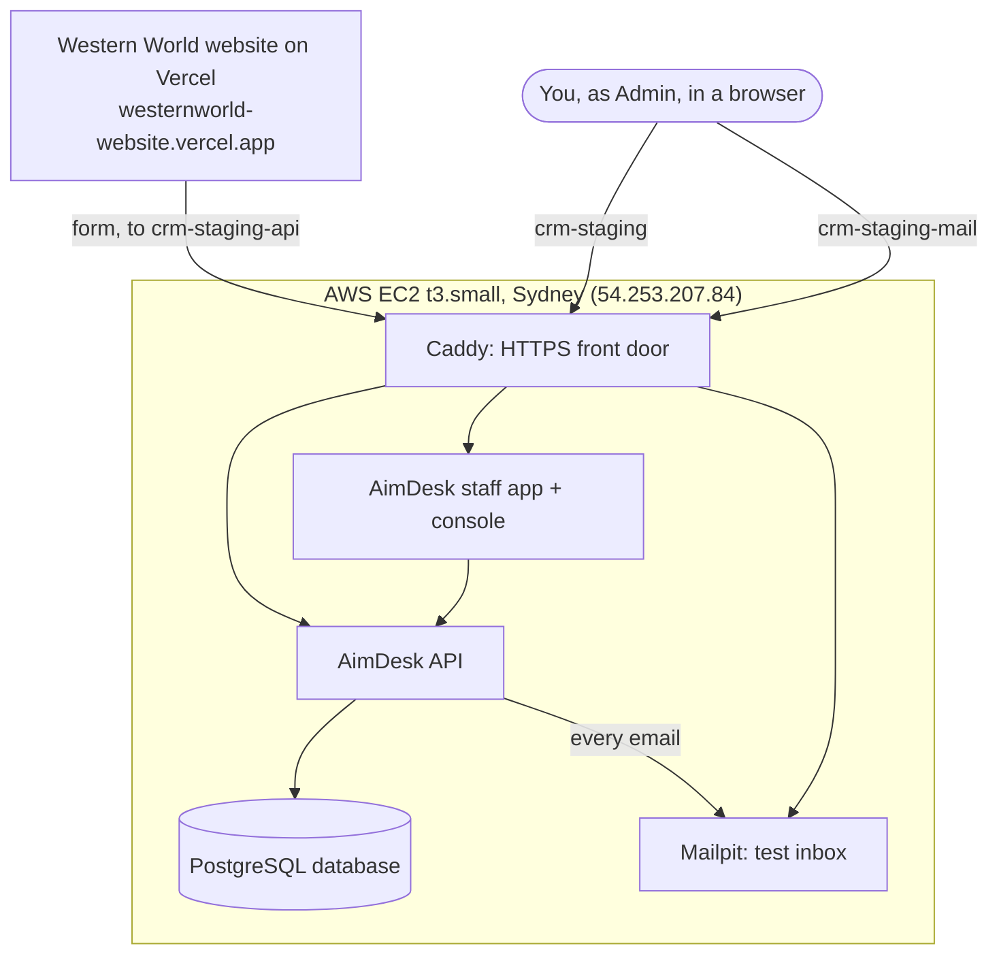

# Staging deploy: website form → AimDesk staging database

**Goal:** someone fills a form on `https://westernworld-website.vercel.app` → the lead is saved in the AimDesk
**staging** database → you, signed in as Admin at `https://crm-staging.softzenithlabs.com`, see it.

**Done when:** step 11 passes. Nothing else is in this plan. The full go-live plan is `docs/go-live.md`.

## Decisions (owner, 16 Oct 2026)

| Topic | Decision | Why |
|---|---|---|
| Hosting | **AWS EC2 free plan**: one `t3.small` (2 vCPU, 2 GB RAM + 2 GB swap, 30 GB disk), Ubuntu 24.04 x86, **Sydney** | Oracle had no free capacity in Mumbai. The AWS free plan gives US$100 credits for 183 days (until 16 Apr 2027); the free project is locked to Sydney |
| Cost | US$0 out of pocket while credits last; about US$25/month is taken from the credits, so they last about **4 months** | Check Billing → Credits monthly. Before they end: upgrade AWS, or move to Hetzner / Oracle (the set-up is the same anywhere) |
| Sign-in on staging | The **mobile + sign-in code** that is already built | No extra work, and the lead list is not open to the internet |
| Email sign-in | Later (task AUTH2) | Proposal: AimDesk emails a one-time code itself through Google Workspace. Free, no Supabase |
| Emails on staging | **Test inbox** (Mailpit) on the server, never real people | See the admin alert email without real email set-up |
| Robot check, WhatsApp, Meta, real email | Not in this plan | Added after this works |

## What we build



| Address (all on softzenithlabs.com) | Opens |
|---|---|
| `crm-staging.softzenithlabs.com` | Staff app (`/login`) and SoftZenith console (`/platform`) |
| `crm-staging-api.softzenithlabs.com` | The API. The Vercel website sends its forms here |
| `crm-staging-mail.softzenithlabs.com` | Test inbox (password protected) |

## Steps

| # | Step | Who | Status |
|---|---|---|---|
| 1 | AWS account (free plan, Sydney) | You | Done |
| 2 | Zero-spend budget alert (Budgets → Create budget → Zero spend template) | You | Check |
| 3 | Server: EC2 `t3.small`, Ubuntu 24.04, key pair `softzenith-staging` | You | Done |
| 4 | Security group: 80 + 443 from anywhere, 22 from My IP; Elastic IP `54.253.207.84` | You | Done (80/443 verified in step 8) |
| 5 | DNS at Hostinger: A `crm-staging`, `crm-staging-api`, `crm-staging-mail` → `54.253.207.84` | You | Done, resolving |
| 6 | Packaging code (C0, C1 below) | Claude | Done: branch `feat/staging-deploy` |
| 7 | Access: key at `C:\Users\naman\.ssh\softzenith-staging.pem` (locked to your user), SSH as `ubuntu` works | You + Claude | Done. No deploy key needed: the repo is public |
| 8 | Install and start | Claude | Done 16 Oct: all 5 containers up, HTTPS on all three addresses, 9 migrations applied, console admin `softzenith` created, nightly backup cron installed and tested |
| 9 | Set up Western World | You | |
| 10 | Connect the Vercel website | You | |
| 11 | Test | You | |

Server checked 16 Oct: Ubuntu 24.04 x86_64, 1.9 GB RAM + 2 GB swap, 24 GB disk free, Docker 29 + Compose v5, git,
Nginx inactive.

### 6. Packaging code (Claude, 2–3 h)

| | What |
|---|---|
| C0 | Commit the finished, uncommitted work (sign-in codes, visitor address) on a branch, merge into `develop`, push. You approve first |
| C1 | `deploy/` folder: Dockerfiles for the API (Java 21, heap capped so everything fits in 2 GB) and the staff app; `docker-compose.yml` with PostgreSQL, API, staff app, Caddy (automatic HTTPS) and Mailpit; `Caddyfile` for the three `crm-staging` addresses (password on the inbox); `staging.env.example`; nightly database dump kept 7 days; one-command deploy script. Pushed to `develop` |

### 8. Install and start (Claude, 30–45 min; you approve each command)

Everything is in the repo's `deploy/` folder (operations guide: `deploy/README.md`).

1. Download the code to `/opt/aimdesk` (the repo is public, so no key is needed).
2. `deploy/setup-env.sh` writes `/opt/aimdesk/deploy/.env` (readable only by the admin user) from
   `deploy/staging.env.example`. Secrets are generated **on the server**, so they never pass through chat:

   | Setting | Value |
   |---|---|
   | `SPRING_PROFILES_ACTIVE` | `prod` |
   | `DB_URL` / `DB_USER` / `DB_PASSWORD` | `jdbc:postgresql://db:5432/crm` / `crm_app` / random |
   | `CRM_AUTH_TOKEN_SECRET`, `CRM_PLATFORM_JWT_SECRET` | random, 48 characters each |
   | `FRONTEND_URL` | `https://crm-staging.softzenithlabs.com` |
   | `MAIL_HOST` / `MAIL_PORT` / `MAIL_FROM` | `mailpit` / `1025` / `noreply@softzenithlabs.com` |
   | `MAILPIT_PASSWORD` | random (test inbox login, user `softzenith`) |
   | `CRM_PLATFORM_ADMIN_USERNAME` / `_PASSWORD` | `softzenith` / random (console login; removed after the first sign-in) |
   | `TURNSTILE_SECRET`, `CRM_TRUSTED_PROXY_SECRET` | empty for now |

3. `deploy/deploy.sh feat/staging-deploy` (later `develop`): builds the API and the staff app one after the other
   (10–20 minutes the first time on 2 GB), then starts everything. Caddy gets the HTTPS certificates by itself.
4. **Checks:** `https://crm-staging-api.softzenithlabs.com/actuator/health` shows `{"status":"UP"}`;
   `https://crm-staging.softzenithlabs.com/login` opens; `https://crm-staging-mail.softzenithlabs.com` asks for a
   password.
5. **You** read the console and inbox passwords yourself and save them in your password manager. In PowerShell:

   ```powershell
   ssh -i C:\Users\naman\.ssh\softzenith-staging.pem ubuntu@54.253.207.84 "grep -E 'CRM_PLATFORM_ADMIN|MAILPIT_PASSWORD' /opt/aimdesk/deploy/.env"
   ```

### 9. Set up Western World (you, 15 min)

1. `https://crm-staging.softzenithlabs.com/platform` → sign in with the console login.
2. Claude removes the two `CRM_PLATFORM_ADMIN_*` lines from `deploy/.env` and restarts the API (the account stays).
3. **Onboard a business → Load file** → `docs/onboarding/westernworld.blueprint.json`.
4. Change the **web address (slug)** from `westernworld` to **`westernworldvisaservices`** (must match the website;
   can't be changed later).
5. Branches: skip for now.
6. Staff: **one row, you**: name, mobile, email, role **Admin** → **Generate** a sign-in code → save it.
7. **Review → Go live.**
8. `https://crm-staging.softzenithlabs.com/login` → your mobile + code → an empty lead list.

### 10. Connect the Vercel website (you, 5 min)

Vercel → `westernworld-website` → **Settings → Environment Variables** → add both, for **Production** and **Preview**:

| Name | Value |
|---|---|
| `CRM_API_URL` | `https://crm-staging-api.softzenithlabs.com` |
| `NEXT_PUBLIC_CRM_TENANT` | `westernworldvisaservices` |

Then **Deployments** → newest → **⋯ → Redeploy** (the values are read when the site is built).

### 11. Test (you, 5 min)

1. `https://westernworld-website.vercel.app` → fill the home-page form with your own details → **Thank you** page.
2. AimDesk → **Leads** → the lead is there (`WWV-000001`), source "Website form". **This plan is done.**
3. Optional: the test inbox shows the welcome email and your new-lead alert.

## If it fails

| What you see | Cause | Fix |
|---|---|---|
| `ssh` times out | Your home IP changed; port 22 only allows "My IP" | Security group → SSH rule → **My IP** again |
| Addresses time out | Ports 80/443 closed in the security group | Inbound rules: HTTP and HTTPS from `0.0.0.0/0` |
| Certificate or "not secure" error | DNS wasn't ready when Caddy started | Claude restarts Caddy |
| Form error: unknown business / not found | Slug mismatch, or Vercel not redeployed | Slug exactly `westernworldvisaservices`; redeploy |
| Form error: something went wrong | `CRM_API_URL` wrong or API down | The health address from step 8 |
| Can't sign in | Wrong mobile or code | Mobile exactly as entered in step 9; 5 wrong tries lock it for 15 minutes |
| Server slow / build killed | 2 GB RAM is tight while building | Claude builds one image at a time; swap is on |

## After this works (not in this plan)

1. Email sign-in (AUTH2).
2. Backups copied off the server (Cloudflare R2 / Backblaze B2, free 10 GB), before any real data.
3. Robot check (Turnstile) and the visitor-address secret, before real traffic.
4. Real email, WhatsApp, Facebook / Instagram leads (`docs/go-live.md`).
5. Before the AWS credits end: upgrade or move the server.
